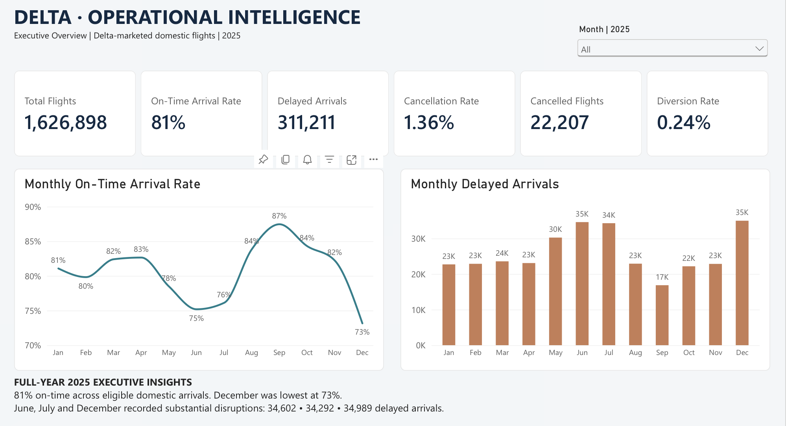
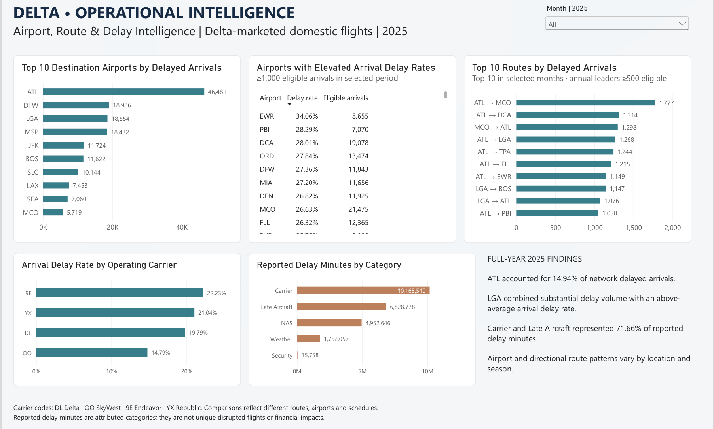
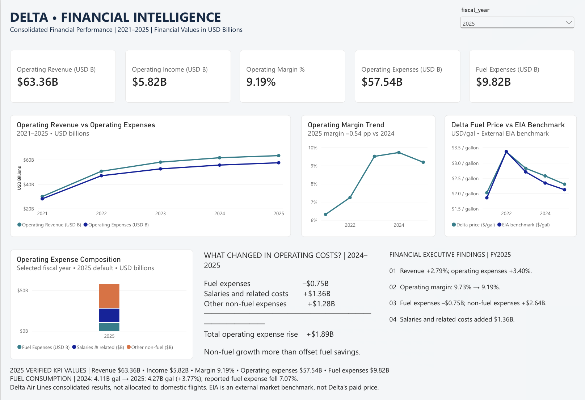

# Delta Air Lines | Project Methodology

## End-to-End Data Analytics, Financial Analysis & Business Intelligence

**Project:** Delta Air Lines | Operational & Financial Intelligence

**Author:** Aamir Sohaib

**Technologies:** Python, Pandas, NumPy, PostgreSQL, SQL, Power BI, DAX, Excel

**Operational Analysis:** January–December 2025

**Financial Analysis:** Fiscal Years 2021–2025

**Status:** Completed descriptive analytics and business intelligence phase

> Independent portfolio project using publicly available data.
> Not affiliated with or endorsed by Delta Air Lines.

---

# 1. Executive Summary

This project follows a structured analytical methodology to examine
Delta Air Lines' operational performance, consolidated financial
results, and fuel-cost environment.

The objective is to demonstrate how data engineering, SQL,
financial analysis, and business intelligence can be combined
to support business decision-making.

The completed project includes:

- Public-source data collection
- Python-based data cleaning and transformation
- PostgreSQL database development
- SQL-based data validation
- Operational performance analysis
- Financial statement and profitability analysis
- Operating expense variance analysis
- Fuel economics analysis
- Power BI semantic modeling
- DAX KPI development
- Three interactive executive dashboards
- Analytical findings and documented limitations

The project analyzes:

| Dataset | Coverage | Records |
|---|---|---:|
| Delta-marketed domestic flights | 2025 | 1,626,898 |
| Consolidated financial statements | 2021–2025 | 5 |
| Monthly jet-fuel prices | 2021–2025 | 60 |
| Airport reference dimension | 2025 | 216 |
| Calendar dimension | 2021–2025 | 1,826 |

These datasets have different reporting populations and are
analyzed accordingly.

---

# 2. Business Problem & Analytical Objectives

## 2.1 Central Business Question

How can historical operational and financial information
help identify performance patterns, financial pressures,
and opportunities for further business investigation?

The project approaches this question through two
complementary analytical perspectives.

### Operational Intelligence

- Measure overall flight reliability.
- Analyze delays, cancellations, and diversions.
- Identify periods of elevated operational disruption.
- Compare airport and directional route performance.
- Examine operating-carrier differences.
- Investigate reported delay-attribution categories.
- Identify patterns relevant to operational planning.

### Financial Intelligence

- Analyze historical operating revenue.
- Examine operating expenses and operating income.
- Evaluate profitability and operating margins.
- Investigate fuel expense and fuel consumption.
- Compare market fuel-price trends.
- Perform year-over-year expense variance analysis.
- Identify financial performance drivers for management review.

## 2.2 Intended Stakeholders

| Stakeholder | Analytical Interest |
|---|---|
| Executive Leadership | Operational and financial performance |
| Airport Operations | Delay rates and disruption concentration |
| Network Planning | Route and scheduling performance |
| Finance / FP&A | Revenue, margins, expenses, cost drivers |
| Business Intelligence Teams | KPI standardization and interactive reporting |

These stakeholders represent the intended audience
for this independent case study.

They do not imply direct engagement with Delta management.

---

# 3. Analytical Framework

The completed project follows a multi-stage workflow.

```text
BUSINESS PROBLEM DEFINITION
             |
             v
PUBLIC DATA COLLECTION
             |
             v
PYTHON DATA PREPARATION
             |
             v
DATA QUALITY VALIDATION
             |
             v
POSTGRESQL DATABASE
             |
             v
SQL ANALYTICAL QUERIES
             |
             v
REPORTING VIEWS
             |
             v
POWER BI SEMANTIC MODEL
             |
             v
DAX KPI DEVELOPMENT
             |
             v
INTERACTIVE DASHBOARDS
             |
             v
BUSINESS INSIGHTS
```

This approach separates:

1. Data acquisition
2. Data processing
3. Data storage
4. Analytical calculations
5. Reporting
6. Business interpretation

Separating these responsibilities improves transparency,
consistency, and maintainability.

---

# 4. Data Collection & Source Selection

Three primary public data sources were selected.

## 4.1 Flight Operations

**Provider:** U.S. Bureau of Transportation Statistics (BTS)

**Dataset:** Marketing Carrier On-Time Performance

**Reporting Period:** January–December 2025

**Source:**

https://www.transtats.bts.gov/Marketing_Annual.aspx

The source provides flight-level information covering:

- Flight dates
- Marketing and operating carriers
- Origin and destination airports
- Scheduled and actual flight times
- Departure and arrival delays
- Cancellations and diversions
- Flight distances
- Reported delay-attribution categories

The dataset was restricted to Delta-marketed
domestic flights.

The operating-carrier field was retained to
distinguish Delta mainline from regional operations.

## 4.2 Financial Statements

**Provider:** Delta Air Lines / U.S. Securities
and Exchange Commission

**Reporting Period:** Fiscal Years 2021–2025

**Sources:**

https://ir.delta.com/

https://www.sec.gov/edgar/browse/?CIK=27904

The analysis uses publicly reported consolidated
financial information, including:

- Operating revenue
- Operating expenses
- Operating income
- Net income
- Operating cash flow
- Aircraft fuel expense
- Salaries and related costs
- Passenger and capacity statistics
- Fuel consumption
- Reported average fuel price

Annual reporting information was assembled using
Delta's published financial disclosures.

## 4.3 Fuel Market Data

**Provider:** U.S. Energy Information Administration

**Series:** U.S. Gulf Coast Kerosene-Type Jet
Fuel Spot Price FOB

**Frequency:** Monthly

**Reporting Period:** January 2021–December 2025

**Source:**

https://www.eia.gov/dnav/pet/hist/eer_epjk_pf4_rgc_dpgM.htm

The EIA series provides external fuel-market context.

It is not treated as Delta's actual realized
fuel purchase price.

### Source Documentation

Detailed information is maintained in:

[Data Source Register](source_register.md)

---

# 5. Python Data Preparation

Python and Pandas were used to prepare the
analysis-ready datasets.

## 5.1 Flight Data Processing

**Script:**

[src/clean_flights.py](../src/clean_flights.py)

The flight-cleaning workflow includes:

1. Reading monthly BTS flight records
2. Processing large CSV files in chunks
3. Filtering Delta-marketed flight records
4. Standardizing source column names
5. Converting dates and numeric indicators
6. Deriving calendar variables
7. Creating directional route identifiers
8. Deriving scheduled departure hours
9. Creating arrival-delay classifications
10. Assigning delay-severity and distance categories
11. Exporting the cleaned analytical dataset

### Memory-Efficient Processing

The script uses Pandas chunk processing.

```python
chunksize=200_000
```

This reduces the need to load the entire source
dataset into memory simultaneously.

### Derived Analytical Features

Examples include:

| Feature | Purpose |
|---|---|
| `year` | Annual reporting |
| `month` | Monthly analysis |
| `month_name` | Readable reporting labels |
| `day_of_week` | Weekday comparisons |
| `route` | Directional route analysis |
| `departure_hour` | Scheduled departure-time analysis |
| `arrival_delayed_15` | Arrival-delay classification |
| `delay_category` | Delay-severity segmentation |
| `distance_band` | Flight-distance comparisons |

### Route Definition

Routes are directional.

For example:

`ATL-MCO`

and:

`MCO-ATL`

are analyzed as separate routes.

This preserves operational differences
between outbound and return directions.

---

## 5.2 Financial Data Preparation

**Script:**

[src/clean_financials.py](../src/clean_financials.py)

The financial preparation process includes:

- Reading annual financial disclosure workbooks
- Extracting selected financial statement measures
- Standardizing numeric values
- Handling accounting-style negative numbers
- Consolidating multiple reporting years
- Tracking the source filing for each observation
- Calculating operating margins
- Exporting the annual financial dataset

### Financial Data Lineage

The prepared financial dataset includes fields
identifying the source filing years used for
financial statements and operating statistics.

This supports traceability when combining
historical information from multiple filings.

### Financial Units

Financial statement values are primarily
stored in USD millions.

Example:

```text
63364 USD millions = $63.364 billion
```

Consistent units are important for calculating
financial ratios and expense variances.

---

## 5.3 Fuel-Price Preparation

**Script:**

[src/clean_fuel.py](../src/clean_fuel.py)

The implemented fuel-cleaning script normalizes
an existing CSV containing the EIA monthly series.

Processing includes:

- Standardizing column names
- Converting dates
- Converting prices to numeric values
- Removing invalid observations
- Restricting the reporting period
- Sorting observations chronologically

The resulting analytical series contains
60 monthly observations from 2021–2025.

**Reproducibility note:** This script processes an
already prepared CSV rather than independently
downloading and parsing the original EIA source.

---

# 6. Data Quality & Validation

Data validation was conducted before relying on
the prepared datasets for analytical reporting.

Validation was implemented using Python and SQL.

## 6.1 Flight Data Validation

**Relevant files:**

- [Python Validation](../src/validate_data.py)
- [SQL Data Quality](../sql/02_data_quality.sql)

The recorded quality checks include:

| Check | Recorded Result |
|---|---:|
| Total Delta-marketed flights | 1,626,898 |
| Missing flight dates | 0 |
| Missing airport codes | 0 |
| Non-Delta marketing records | 0 |
| Invalid cancellation indicators | 0 |
| Missing arrival delays among otherwise eligible flights | 1 |

### Documented Exception

One flight was not cancelled or diverted
but had a missing arrival-delay value.

The record was retained in the operational
dataset and excluded from arrival-punctuality KPIs.

This avoids treating an unknown outcome as
either on-time or delayed.

## 6.2 Financial Validation

Financial checks included:

- Five-year reporting coverage
- Duplicate fiscal-year checks
- Missing-value checks
- Financial unit consistency
- Operating margin recalculation
- Operating income reconciliation
- Expense variance reconciliation

## 6.3 Fuel Data Validation

The fuel-validation script includes checks for:

- Missing months
- Duplicate months
- Missing prices
- Invalid dates
- Non-positive prices
- Expected reporting coverage

The analyzed data contains the expected
60 monthly observations.

## 6.4 Validation Evidence

Recorded results support the principal
operational and financial calculations.

However, complete archived execution logs
and independent reproduction evidence are
not yet published for every validation check.

Detailed findings and remaining evidence
requirements are documented in:

[Data Validation Report](validation_report.md)

---

# 7. PostgreSQL Database Development

The analytical database was developed
using PostgreSQL.

**Database Name:** `delta_operations`

## 7.1 Implemented Tables

| Table | Purpose |
|---|---|
| `flights` | Flight-level operational records |
| `financials` | Annual consolidated financial information |
| `fuel_prices` | Monthly EIA fuel prices |
| `calendar` | Date dimension |
| `airports` | Airport reference dimension |

The database separates operational facts,
financial results, and supporting dimensions.

## 7.2 Database Development Files

[Core Table Definitions](../sql/01_create_tables.sql)

[Calendar and Airport Dimensions](../sql/01b_create_dimensions.sql)

### Important Execution Note

The initial table-creation script contains
`DROP TABLE` statements.

It is intended for initial setup and
should not be rerun against a populated database
without reviewing the destructive operations.

## 7.3 Database Documentation

Complete field definitions, data types,
and analytical relationships are available in:

[Data Dictionary](data_dictionary.md)

---

# 8. SQL Analytical Methodology

SQL was used to investigate operational
performance and consolidated financial trends.

**Primary file:**

[03_analysis.sql](../sql/03_analysis.sql)

## 8.1 Operational Analysis

The analytical queries cover:

- Network-wide operational KPIs
- Monthly performance trends
- Airport performance
- Airport seasonality
- Directional route performance
- Departure-time analysis
- Operating-carrier comparisons
- Delay attribution
- Attribution reconciliation

## 8.2 Comparative Analysis

Operational comparisons consider both:

**Absolute measures**

Such as delayed-flight counts.

**Normalized measures**

Such as delayed-arrival percentages.

This is important because high-volume airports
may naturally account for more total delays.

A high delay count alone does not establish
poor relative operational performance.

## 8.3 Minimum Sample Thresholds

Minimum flight-volume thresholds were used
in selected Power BI comparisons.

Examples include:

- At least 1,000 eligible arrivals in selected
  airport delay-rate comparisons
- At least 500 annual eligible arrivals in
  selected directional route comparisons

These thresholds reduce the influence
of very small observation groups.

They do not establish statistical causality.

## 8.4 Financial SQL Analysis

Financial queries examine:

- Operating revenue trends
- Operating income
- Operating margins
- Revenue and expense changes
- Fuel expenses
- Salaries and related costs
- Other non-fuel operating expenses
- Year-over-year financial variances

The objective is to identify and explain
historical business performance patterns.

---

# 9. KPI Development

A consistent KPI framework was established
to support SQL and Power BI reporting.

## 9.1 Arrival Performance

An eligible arrival satisfies:

```text
cancelled = 0

AND diverted = 0

AND arrival_delay IS NOT NULL
```

A delayed arrival is an eligible flight
arriving at least 15 minutes late.

### On-Time Arrival Rate

```text
On-Time Arrival Rate =

(Eligible Arrivals - Delayed Arrivals)
-------------------------------------
          Eligible Arrivals
```

### Validated Annual Results

| Metric | Result |
|---|---:|
| Total Flights | 1,626,898 |
| Eligible Arrivals | 1,600,753 |
| Delayed Arrivals | 311,211 |
| On-Time Arrival Rate | 80.56% |
| Arrival Delay Rate | 19.44% |
| Cancellation Rate | 1.36% |
| Diversion Rate | 0.24% |

Cancellation and diversion rates use
the complete flight-record population.

Arrival-punctuality rates use only
eligible completed flights.

## 9.2 Financial KPIs

### Operating Income

```text
Operating Income =
Operating Revenue - Operating Expenses
```

### Operating Margin

```text
Operating Margin =
Operating Income / Operating Revenue
```

### Expense Variance

```text
Expense Variance =
Current Period Expense - Prior Period Expense
```

The financial analysis distinguishes
absolute expense changes from percentage
changes and changes in profitability.

---

# 10. SQL Reporting Views

Seven PostgreSQL views were developed
for Power BI reporting.

**Source file:**

[04_powerbi_views.sql](../sql/04_powerbi_views.sql)

| Reporting View | Analytical Grain |
|---|---|
| `vw_monthly_operations` | Month |
| `vw_airport_monthly_operations` | Airport × Month |
| `vw_route_monthly_operations` | Directional Route × Month |
| `vw_monthly_delay_causes` | Delay Cause × Month |
| `vw_carrier_monthly_operations` | Operating Carrier × Month |
| `vw_financial_performance` | Fiscal Year |
| `vw_fuel_economics` | Fiscal Year |

### Why Reporting Views Were Used

Reporting views provide:

- Consistent KPI definitions
- Structured analytical outputs
- Reduced reporting-data volume
- Separation of SQL calculations from visualization
- Reusable business measures

The reporting views were exported
into a structured Excel workbook
for import into Power BI Online.

---

# 11. Power BI Semantic Modeling

The Power BI reporting solution was
developed using Microsoft Power BI Online.

## 11.1 Reporting Tables

Seven reporting tables were imported:

1. `tblMonthlyOperations`
2. `tblAirportMonthlyOperations`
3. `tblRouteMonthlyOperations`
4. `tblMonthlyDelayCauses`
5. `tblCarrierMonthlyOperations`
6. `tblFinancialPerformance`
7. `tblFuelEconomics`

A dedicated calculated month dimension
was also created:

`DimMonth`

## 11.2 Relationship Design

Five active one-to-many relationships
connect `DimMonth` to the operational
reporting tables.

These relationships support
consistent filtering by month.

The financial and fuel-economics tables
are related through fiscal year using
an active one-to-one relationship.

The model avoids unnecessary direct
relationships between operational facts.

## 11.3 DAX Calculations

The completed Power BI development audit
recorded:

- 52 base measures
- Seven additional financial display measures

DAX measures support:

- Flight performance KPIs
- Percentage calculations
- Dynamic reporting
- Financial performance measures
- Expense comparisons
- Financial value formatting

The full measure-definition export is
not yet published in this repository.

Detailed implementation information
is available in:

[Power BI Technical Documentation](../powerBI/POWER_BI_TECHNICAL_DOCUMENTATION.md)

---

# 12. Power BI Dashboard Development

Three interactive report pages were developed.

## 12.1 Executive Overview



### Purpose

Provide a concise view of network-wide
operational performance.

### Main Capabilities

- Executive KPI cards
- On-time arrival performance
- Delayed-arrival monitoring
- Cancellation and diversion rates
- Monthly performance analysis
- Interactive filtering
- Full-year executive insights

### Key Result

The annual on-time arrival rate was
80.56%, displayed as 81% in the
executive KPI card.

---

## 12.2 Operational Intelligence



### Purpose

Investigate performance differences
across operating locations, routes,
carriers, and delay categories.

### Main Capabilities

- Airport delay comparisons
- Route performance analysis
- Operating-carrier comparisons
- Delay attribution
- Monthly filtering
- Operational findings

### Key Result

Atlanta accounted for 46,481
delayed arrivals, approximately
14.94% of delayed arrivals in the
analyzed operational population.

This identifies an important concentration
for further investigation.

It does not establish the root cause
of those delays.

---

## 12.3 Financial Intelligence



### Purpose

Support analysis of Delta's consolidated
financial performance and cost structure.

### Main Capabilities

- Revenue and expense analysis
- Operating income reporting
- Operating margin trends
- Fuel economics
- Operating expense composition
- Year-over-year expense variance
- Fiscal-year filtering

### FY2025 Financial Results

| KPI | FY2025 |
|---|---:|
| Operating Revenue | $63.36B |
| Operating Expenses | $57.54B |
| Operating Income | $5.82B |
| Operating Margin | 9.19% |
| Fuel Expense | $9.82B |

### Profitability Trend

Operating margin decreased from
9.73% in FY2024 to 9.19% in FY2025.

This represents a decline of
approximately 0.54 percentage points.

---

# 13. Financial Variance Analysis

A major analytical objective was
to examine changes in operating expenses.

## FY2025 vs FY2024

| Expense Category | Change |
|---|---:|
| Aircraft Fuel | -$747M |
| Salaries and Related Costs | +$1,359M |
| Other Non-Fuel Expenses | +$1,282M |
| Total Operating Expenses | +$1,894M |

### Reconciliation

```text
-$747M + $1,359M + $1,282M = +$1,894M
```

### Business Interpretation

Fuel expenses decreased.

However, salaries and other non-fuel
operating expenses increased sufficiently
to produce higher overall operating costs.

This demonstrates the importance of
analyzing expense composition rather
than examining total expense alone.

### FP&A Relevance

This analytical approach supports:

- Financial performance review
- Expense variance analysis
- Profitability assessment
- Cost driver investigation
- Management reporting
- Historical financial decision support

It is not presented as a completed
budgeting or forward-looking forecast model.

---

# 14. Dashboard Validation & Quality Assurance

The Power BI solution underwent
a multi-stage review.

## Validation Activities

- SQL-to-Power BI KPI reconciliation
- DAX calculation review
- Month relationship validation
- Financial-year relationship review
- Month slicer testing
- Financial-year slicer testing
- Operating expense reconciliation
- Chart presentation checks
- Numerical formatting improvements
- Reading-view verification

## Confirmed Examples

| Test | Result |
|---|---|
| Annual on-time rate | Passed |
| September punctuality | Passed |
| December punctuality | Passed |
| FY2025 operating revenue | Passed |
| FY2025 operating income | Passed |
| FY2025 operating margin | Passed |
| Expense variance reconciliation | Passed |
| Monthly chart ordering | Passed |
| Slicer interactions | Passed |

The complete validation framework
is documented in:

[Data Validation Report](validation_report.md)

---

# 15. Business Interpretation Framework

The project distinguishes three types
of analytical conclusions.

## 15.1 Observed Results

These are measured values supported
by the analytical datasets.

Example:

December had the lowest monthly
on-time arrival rate in 2025.

## 15.2 Analytical Associations

These are patterns observed across
different variables or reporting groups.

Example:

Certain scheduled departure windows
had higher observed delay rates.

Such patterns do not independently
establish causation.

## 15.3 Potential Business Actions

These are recommendations for further
investigation or management evaluation.

Examples:

- Review periods with elevated delays.
- Investigate high-disruption airport patterns.
- Assess scheduling processes associated with delays.
- Monitor major operating expense components.
- Evaluate profitability trends.

No unsupported operational savings
or financial benefits are claimed.

---

# 16. Analytical Limitations

## Different Reporting Populations

Operational data covers Delta-marketed
domestic flights in 2025.

Financial data covers Delta's
consolidated results from 2021–2025.

The project does not allocate
consolidated profitability to
individual domestic flights or routes.

## Delay Attribution

BTS delay-attribution fields represent
reported categories.

They are not independent proof
of operational root causes.

An unusual late-aircraft attribution
pattern was also observed for
SkyWest-operated flights.

This limitation is documented
in the analytical findings.

## Fuel Price Interpretation

EIA fuel spot prices provide
external market context.

They are not equivalent to Delta's
actual realized fuel purchase prices.

## Historical Analysis

The dashboards use historical data.

They are not connected to
real-time operational systems.

## Validation Evidence

Principal analytical results were
reconciled during development.

However, complete execution logs,
the exported DAX inventory, and a
fully reusable Power BI project
artifact have not yet been published.

---

# 17. Reproducibility & Project Assets

The repository contains the principal
Python and SQL implementation.

## Python Scripts

- [Flight Data Cleaning](../src/clean_flights.py)
- [Financial Data Cleaning](../src/clean_financials.py)
- [Fuel Data Cleaning](../src/clean_fuel.py)
- [Data Validation](../src/validate_data.py)

## SQL Scripts

- [Core Database Tables](../sql/01_create_tables.sql)
- [Dimension Tables](../sql/01b_create_dimensions.sql)
- [Data Quality Checks](../sql/02_data_quality.sql)
- [Analytical Queries](../sql/03_analysis.sql)
- [Reporting Views](../sql/04_powerbi_views.sql)

## Documentation

- [Data Source Register](source_register.md)
- [Data Dictionary](data_dictionary.md)
- [Data Validation Report](validation_report.md)
- [Power BI Technical Documentation](../powerBI/POWER_BI_TECHNICAL_DOCUMENTATION.md)

## Reproduction Considerations

The original large BTS flight datasets
are not included in the GitHub repository.

The Power BI reporting workbook is available
in the repository at:

powerBI/Delta_Operational_Intelligence_PowerBI_Data.xlsx

It contains the seven reporting datasets
used to develop the Power BI dashboards.

However, the complete Power BI semantic model,
including exported DAX measure definitions,
has not yet been published as a reusable artifact.

This limits independent reproduction of the
complete interactive Power BI reports.

A complete automated rebuild from
an empty environment has not yet
been demonstrated.

These limitations should be
considered when reproducing the project.

---

# 18. Future Development

The following phases are planned
and are not part of the completed
descriptive reporting solution.

## 18.1 Predictive Flight Delay Modeling

Develop a model estimating whether
an eligible flight is likely to
arrive at least 15 minutes late.

The proposed approach includes:

- Pre-departure feature selection
- Data leakage prevention
- Chronological data splitting
- Baseline model development
- Machine learning model comparison
- Predictive performance evaluation
- Model explainability
- Operational risk segmentation

**Status: Planned**

## 18.2 Business Analysis Improvement Case

Develop a structured operational
improvement proposal based on
validated analytical findings.

Potential deliverables include:

- Problem statement
- Stakeholder assessment
- Root-cause investigation
- AS-IS and TO-BE process analysis
- Business requirements
- Proposed actions
- Performance measures
- Acceptance criteria

**Status: Planned**

---

# 19. Skills Demonstrated

## Data Analytics & Engineering

- Python
- Pandas
- NumPy
- Data Cleaning
- Data Transformation
- Data Validation
- PostgreSQL
- SQL
- Relational Data Modeling
- Analytical Query Development

## Business Intelligence

- Power BI
- DAX
- Semantic Modeling
- KPI Development
- Dashboard Design
- Interactive Reporting
- Data Visualization
- Executive Reporting

## Financial Analysis & FP&A

- Financial Statement Analysis
- Operating Margin Analysis
- Profitability Assessment
- Expense Variance Analysis
- Fuel Economics
- Cost Driver Identification
- Financial Performance Reporting

## Business Problem-Solving

- Analytical Problem Definition
- Comparative Performance Analysis
- KPI Standardization
- Data Quality Management
- Stakeholder-Oriented Reporting
- Evidence-Based Business Insights

---

# 20. Conclusion

The completed project demonstrates
an end-to-end analytical workflow
combining operational data,
consolidated financial reporting,
database development, SQL analysis,
and business intelligence.

The methodology connects:

**Business Problem → Data Collection → Python Processing →
PostgreSQL → SQL Analysis → Power BI → Business Insights**

It demonstrates how technical analytics
and financial knowledge can be combined
to investigate business performance
and communicate findings to decision-makers.

The project provides evidence of
skills relevant to:

- Data Analyst
- FP&A Analyst
- Financial Analyst
- Business Intelligence Analyst
- Business Analyst

---

**Independent portfolio project.**

**Author:** Aamir Sohaib

**LinkedIn:**  
https://www.linkedin.com/in/aamir-sohaib-706889104/

*This project is not affiliated with or endorsed by Delta Air Lines.*